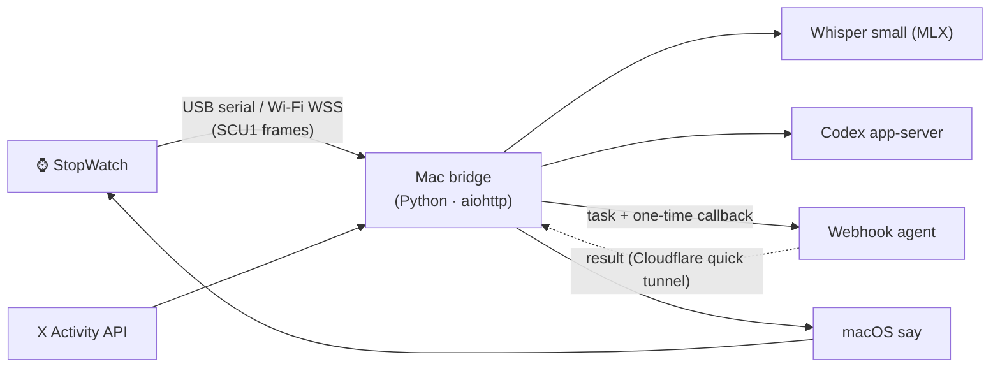

<p align="center">
  
</p>

<p align="center">
  <a href="LICENSE"></a>
  
  
  
  
</p>

<p align="center"><a href="README.md">中文</a> · <b>English</b></p>

<p align="center">🆕 <b>v0.5.4</b>: pick which X notice types to receive · v0.5.3: no more lag with many avatars (firmware 0.5.1) · v0.5.0: swipe to switch avatars, triple-tap to laugh · <a href="CHANGELOG.md">Changelog</a> (Chinese)</p>

**Jax StopWatch** turns an [M5Stack StopWatch](https://docs.m5stack.com/) round-screen watch into a pocket AI remote. **Hold A, talk, release.** Your Mac transcribes the audio locally, hands the text to Codex or your own webhook agent, and speaks the answer back through the watch. It keeps working away from home over a phone hotspot, buzzes for new X followers, mentions and replies, and its on-screen companion can change outfits.

"Jax" (贾克斯) is the name of the desk pet. The UI and voice are in Chinese by default; docs are mostly Chinese with this English overview.

## Meet the companions

<table>
  <tr>
    <td align="center"><br><b>Nuo</b> · pocket courier</td>
    <td align="center"><br><b>Orbit</b> · quiet star mage</td>
    <td align="center"><br><b>Little Host</b> · show host</td>
  </tr>
</table>

Lips follow the voice level, eyes blink, a happy face shows when a task is done, a tap makes it giggle and three quick taps make it laugh; swipe left or right on the watch to switch avatars.

**Four built-in looks**: the device's default face plus the three open-source avatars above, switchable from the console. **Want your own?** Hand the [avatar spec](docs/avatars.md) to your AI agent, describe the character, and it will draw the 16 frames, the happy face and the touch reactions, self-check them and upload them to the watch.

> 💾 **Storage**: the watch has about 3.4 MB for avatars. The three bundled sets (with touch reactions) take about 1.2 MB; a custom set takes 0.3–0.5 MB, so 4–7 more fit. The console shows used space; see [capacity](docs/avatars.md#8-容量参考).

## The home screen

Designed for the 466×466 round display: clock on top, one status row at the bottom (assistant · link · battery), X notice badges along the right edge (counts per kind, each expires after 30 minutes), and the talking avatar in the middle.

<p align="center"></p>

<p align="center"><br>
<sub>Left: link states (USB / LAN / Funnel / connecting / no Wi-Fi / Mac unreachable) · Right: notices (follow / reply / mention / repost / quote)</sub></p>

## Features

- **Push-to-talk** — hold A to speak; tap B to switch assistant, double-tap B to stop.
- **Two kinds of assistant** — [Codex](https://github.com/openai/codex) via `codex app-server` (uses your ChatGPT login, works on files in a local workspace), or any cloud agent reachable by webhook (Grok Bot routines, Cursor Automations, …) with a one-time callback.
- **Private speech** — Whisper small on MLX, offline on the Mac; replies via macOS `say`. Audio never leaves the machine.
- **Works anywhere** — USB when plugged in; otherwise home Wi-Fi straight to the Mac over pinned TLS, or a phone hotspot through Tailscale Funnel. Per-device keys, written over USB only.
- **X alerts** — follows, mentions, replies, reposts and quotes in real time: vibration, speech and an icon that expires after 30 minutes; shake the watch while the icon shows to hear the latest one again.
- **Swappable avatars** — 16 mouth × eye frames plus a happy face; upload from the console, switch there or by swiping on the watch, no reflashing.
- **Local console** at `http://127.0.0.1:18765` for history, Codex approvals, wireless pairing and avatars.

## How it works



The firmware is a fork of [stackchan-pet-fw](https://github.com/Corvelis/stackchan-pet-fw), kept as the [`firmware/`](https://github.com/BTCUP99/stackchan-pet-fw/tree/mac-bridge) submodule. See [architecture](docs/architecture.md) for ports, files and the device protocol.

## Easiest setup: hand it to your agent

No command-line experience needed. Send this to an AI coding agent that can run commands on your Mac ([Claude Code](https://claude.com/claude-code), Codex, …):

```text
Please install Jax StopWatch for me following docs/agent-install.md in https://github.com/BTCUP99/jax-stopwatch
```

It checks your Mac, installs everything, backs up the factory firmware and flashes the watch, asking you before every risky step. Ask it anything along the way, or keep working with it to tweak voices, alerts or avatars. The [agent guide](docs/agent-install.md) tells it exactly what to do and what needs your consent.

## Quick start (manual)

You need an M5Stack StopWatch, a USB-C data cable, an Apple silicon Mac and [uv](https://docs.astral.sh/uv/).

```sh
git clone --recursive https://github.com/BTCUP99/jax-stopwatch.git
cd jax-stopwatch
scripts/setup.sh                    # Python env + pinned, checksummed speech models (~500 MB)
scripts/start.command               # console at http://127.0.0.1:18765
scripts/flash.sh --first-install    # first flash (erases the watch; back it up first)
```

Back up the factory firmware before the first flash ([how](docs/setup.md#2-备份原厂固件)). Later updates use plain `scripts/flash.sh`, which keeps Wi-Fi pairing and avatars.

## Docs (Chinese)

[Agent-guided setup](docs/agent-install.md) · [Setup & flashing](docs/setup.md) · [Daily use](docs/usage.md) · [Wireless](docs/wireless.md) · [Assistants & X alerts](docs/assistants.md) · [Avatar spec](docs/avatars.md) · [Architecture](docs/architecture.md)

## Security

The console listens on localhost only and rejects cross-site requests. Only `/device` (device key, rate-limited) and one-time callback URLs are reachable from outside. Secrets live in `runtime/` (mode 700) and are git-ignored. The watch never listens on a port.

## Credits & license

Firmware derived from [Corvelis/stackchan-pet-fw](https://github.com/Corvelis/stackchan-pet-fw) (MIT, © あいろぐ). Speech models: [Whisper](https://github.com/openai/whisper) via [mlx-community](https://huggingface.co/mlx-community/whisper-small-mlx), [Silero VAD](https://github.com/snakers4/silero-vad). See [THIRD_PARTY_NOTICES.md](THIRD_PARTY_NOTICES.md).

Code and avatars are released under the [MIT License](LICENSE). M5Stack, StopWatch, Codex, Grok, X and Tailscale are trademarks of their owners; this project is not affiliated with them.
