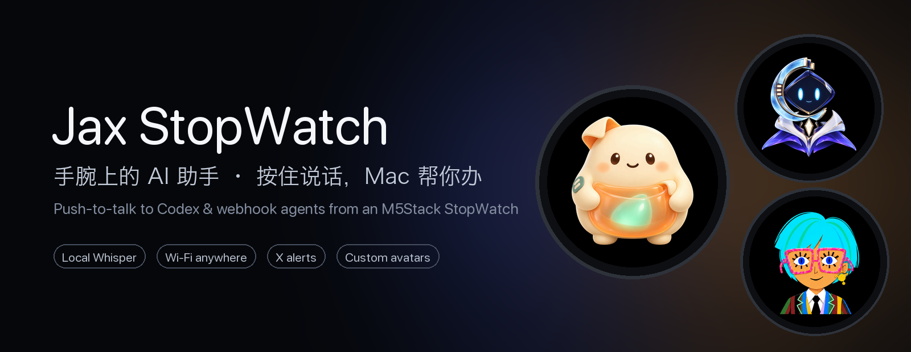
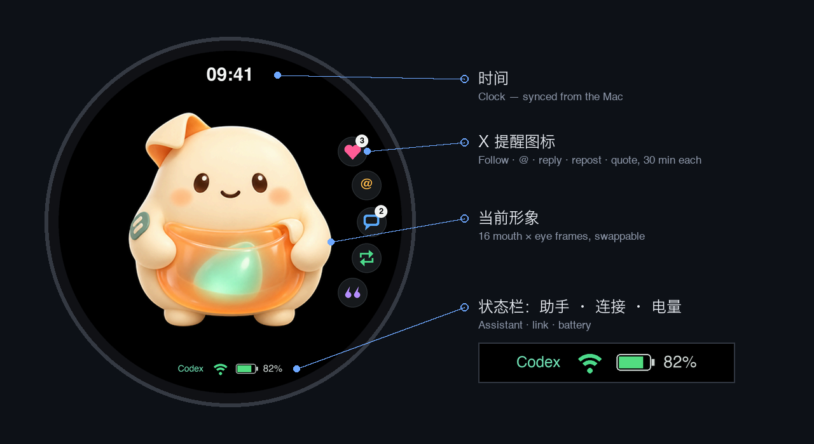
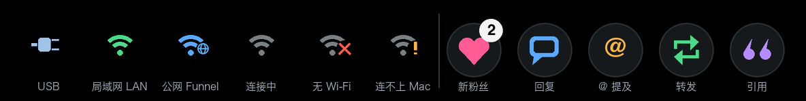
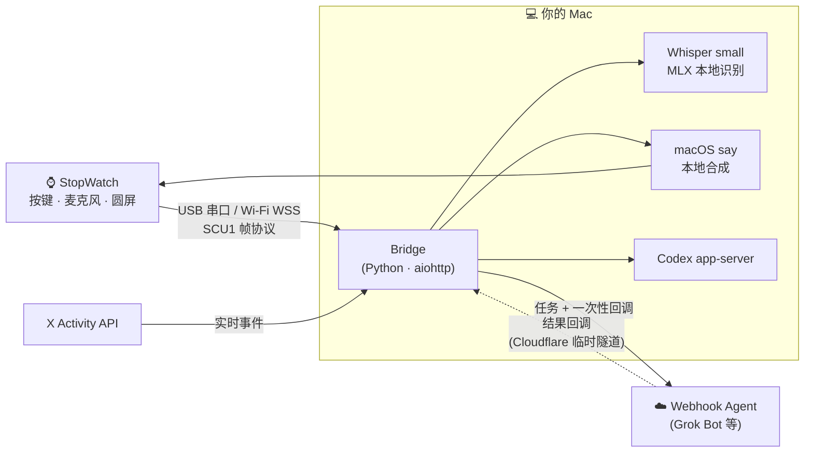

<p align="center">
  
</p>

<p align="center">
  <a href="LICENSE"></a>
  
  
  
  
</p>

<p align="center"><b>中文</b> · <a href="README.en.md">English</a></p>

<p align="center">🆕 <b>v0.4.1</b>：摇一摇重播最新 X 提醒 · v0.4.0：触摸表情 · <a href="CHANGELOG.md">更新日志</a></p>

**Jax StopWatch** 把一块 [M5Stack StopWatch](https://docs.m5stack.com/) 圆屏手表变成你的随身 AI 入口：**按住 A 键说话，松开发送**，家里的 Mac 在本地把语音转成文字，交给 Codex 或你自己的 Webhook 助手去办，再把结果用语音播回手表。出门在外经手机热点也能用，X 上有新粉丝、@ 和回复会实时振动提醒，屏幕上的小伙伴可以随时换装。

“Jax（贾克斯）”是这只桌面宠物的名字。

## 它长这样

<table>
  <tr>
    <td align="center"><br><b>糯邮</b> · 暖心口袋信使</td>
    <td align="center"><br><b>弦核</b> · 安静的星际小法师</td>
    <td align="center"><br><b>小主播</b> · 彩条西装主持人</td>
  </tr>
</table>

说话时嘴型跟着音量开合、会眨眼；任务完成后露出开心表情；轻点它会嘻嘻调皮，来回抚摸会哈哈大笑。

**内置 4 款形象**：设备自带的默认脸，加上面这三套开源形象，在控制台一键切换。**想要自己的形象？** 把[形象制作规范](docs/avatars.md)交给你的 Agent，告诉它你想要什么样的角色，它会按规范画好 16 帧、开心表情和触摸表情、自检，再帮你上传到手表。

> 💾 **存储空间**：手表留给形象的空间约 3.4MB。三套自带形象（含触摸表情）共约 1.2MB，每套自制形象约 0.3–0.5MB，还能再放 4–7 套。控制台会显示已用空间，详见[容量参考](docs/avatars.md#8-容量参考)。

## 首页面板

专门为 466×466 圆屏设计的首页：顶部时间，底部一行状态栏（当前助手 · 连接方式 · 电量），右侧沿圆边排列 X 提醒图标（同类多条显示数量，每条 30 分钟后自动消失），中间是会说话、会眨眼的形象。

<p align="center"></p>

<p align="center"><br>
<sub>左：连接图标（USB / 局域网 / 公网 / 连接中 / 无 Wi-Fi / 连不上 Mac）· 右：提醒图标（新粉丝 / 回复 / @ / 转发 / 引用）</sub></p>

## 能做什么

| | 功能 | 说明 |
|---|---|---|
| 🎙️ | **按键对讲** | 按住 A 讲话，松开发送；单击 B 切换助手，双击 B 停止。 |
| 🧠 | **两类助手** | [Codex](https://github.com/openai/codex)（沿用 ChatGPT 登录，在本机工作区里改文件、写脚本），或任何能接收 Webhook 的云端 Agent（例如 Grok Bot / Cursor Automations）。 |
| 🔒 | **本地语音** | 识别用 MLX 版 Whisper small，在 Mac 上离线完成；播报用 macOS 自带语音。录音不出本机。 |
| 📶 | **哪里都能连** | 插着 USB 走有线；拔掉后自动连家里 Wi-Fi 直连 Mac，在外经手机热点 + Tailscale Funnel 连回家，都是加密连接、设备独立密钥。 |
| 🔔 | **X 提醒** | 新粉丝、@ 提及、回复、转发、引用实时推送：振动 + 播报 + 屏幕右侧图标，30 分钟后自动消失；图标还在时摇一摇手表可重播最新一条。 |
| 🎨 | **可换形象** | 16 帧嘴型 × 眼睛 + 开心表情，控制台一键上传、切换，无需刷机。 |
| 🖥️ | **本机控制台** | `http://127.0.0.1:18765`：看对话、审批 Codex 操作、配对无线、管理形象，只对本机开放。 |

## 工作原理



- **手表固件**基于开源的 [stackchan-pet-fw](https://github.com/Corvelis/stackchan-pet-fw)，以子模块 [`firmware/`](https://github.com/BTCUP99/stackchan-pet-fw/tree/mac-bridge) 维护，新增 Mac 接入、无线链路、首页状态栏、提醒图标和形象存储。
- **Mac 端** 在 [`src/`](src/)：设备会话、语音识别、助手调度、无线入口、X 订阅和控制台都在一个进程里。
- 详细的数据流、端口和协议见 [架构说明](docs/architecture.md)。

## 准备

- 一台 **M5Stack StopWatch**（ESP32-S3，8MB PSRAM，466×466 圆屏）和一根 USB-C 数据线
- 一台 **Apple silicon Mac**（macOS 14+），装好 [uv](https://docs.astral.sh/uv/)
- 可选：[Codex CLI](https://github.com/openai/codex) 并登录 ChatGPT；一个 Webhook Agent；[Tailscale](https://tailscale.com/)（在外使用）；X 开发者应用（提醒）

## 最省心的安装：交给你的 Agent

不熟悉命令行也没关系。把下面这句话发给你的 AI 编程助手（[Claude Code](https://claude.com/claude-code)、Codex 等能在你电脑上执行命令的 Agent）：

```text
请按 https://github.com/BTCUP99/jax-stopwatch 的 docs/agent-install.md 帮我安装 Jax StopWatch。
```

它会检查环境、安装、备份原厂固件、刷机，并在每个关键步骤先问你。过程中遇到任何问题，直接用大白话问它；想调整功能（换声音、加提醒、改形象），也可以继续和它商量着改。[Agent 安装指南](docs/agent-install.md) 里写明了它该怎么做、哪些操作必须先征得你同意。

## 快速开始（手动）

```sh
git clone --recursive https://github.com/BTCUP99/jax-stopwatch.git
cd jax-stopwatch
scripts/setup.sh          # Python 环境 + 下载并校验本地语音模型（约 500MB）
scripts/start.command     # 启动 Mac 端，打开 http://127.0.0.1:18765
scripts/flash.sh --first-install   # 插上手表，首次刷入（会清空整片 Flash，先备份）
```

刷完后手表自动连上 Mac，按住 A 说“你好”试试。下一步：

1. 想开机自动运行：`.venv/bin/python src/manage.py autostart on`
2. 想拔线也能用：控制台 →“无线组网”，见 [无线组网](docs/wireless.md)
3. 想接 Grok Bot 或 X 提醒：见 [助手与提醒](docs/assistants.md)
4. 想换个形象：控制台 →“形象管理”，点“上传并使用”

> 第一次刷机前，建议先按 [安装与刷机](docs/setup.md#2-备份原厂固件) 备份手表的原厂完整镜像。

## 文档

| 文档 | 内容 |
|---|---|
| [交给 Agent 安装](docs/agent-install.md) | 给 AI 助手的分步安装指南，用户只需一句话 |
| [安装与刷机](docs/setup.md) | 环境、模型、刷固件、备份与恢复、开机自启动 |
| [日常使用](docs/usage.md) | 按键、首页图标、语音指令技巧、音量、排障 |
| [无线组网](docs/wireless.md) | 局域网直连、Tailscale Funnel、安全模型、配对 |
| [助手与提醒](docs/assistants.md) | Codex、Webhook Agent（含例程模板）、X 提醒 |
| [形象制作规范](docs/avatars.md) | 画布、安全区、16 帧规则、开心表情、交付与自检 |
| [架构说明](docs/architecture.md) | 组件、端口、运行时文件、设备协议与命令 |

## 仓库结构

```
jax-stopwatch/
├── src/                 Mac 端：bridge、设备链路、语音、Codex、无线入口、X 提醒、控制台
├── tests/               单元测试（python -m unittest）
├── firmware/            子模块 → BTCUP99/stackchan-pet-fw（mac-bridge 分支）
├── avatars/             开源形象：糯邮、弦核、小主播（PNG 原图）
├── scripts/             setup / start / stop / flash / 模型下载 / README 配图
├── docs/                文档与配图
├── runtime/             运行时状态与私密配置（不入库）
├── models/              本地语音模型（脚本下载，不入库）
└── workspace/           Codex 的默认工作区（不入库）
```

## 安全与隐私

- 控制台只监听 `127.0.0.1`，并校验来源与自定义请求头，网页不能被其他网站跨站调用。
- 公网只暴露设备入口 `/device`，每台设备一把随机密钥，Mac 只存哈希；失败限速并封禁。Wi-Fi 密码和密钥只经 USB 写入设备。
- 录音只在内存中处理；凭据、会话、事件记录都在本机 `runtime/`，权限 `700`，不会进入仓库。
- 设备不监听任何端口，只主动连出；局域网连接固定校验 Mac 的自签证书。

## 路线图

- [ ] 待机呼吸、思考中、倾听的形象动画（规范已预留第二阶段帧）
- [ ] “摇一摇”重播上一条结果
- [ ] Webhook 助手的多轮上下文
- [ ] 更多设备（M5Stack CoreS3 / AtomS3R，上游固件已支持）

欢迎提 Issue 和 PR，参见 [贡献指南](CONTRIBUTING.md)。

## 致谢与许可

- 手表固件派生自 [Corvelis/stackchan-pet-fw](https://github.com/Corvelis/stackchan-pet-fw)（MIT，© あいろぐ），感谢原作者开放源码。
- 语音模型：[Whisper](https://github.com/openai/whisper)（MIT）的 [MLX 转换版](https://huggingface.co/mlx-community/whisper-small-mlx)、[Silero VAD](https://github.com/snakers4/silero-vad)（MIT）。
- 第三方组件清单见 [THIRD_PARTY_NOTICES.md](THIRD_PARTY_NOTICES.md)。

本仓库代码与 `avatars/` 中的形象以 [MIT License](LICENSE) 发布。M5Stack、StopWatch、Codex、Grok、X、Tailscale 等名称归各自所有者，本项目与它们没有官方关联。
