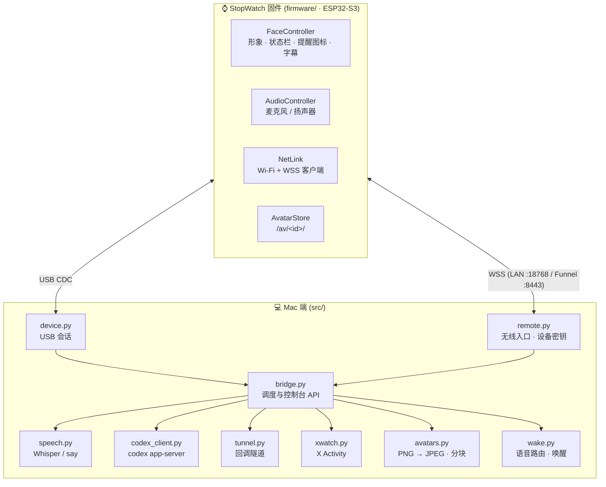
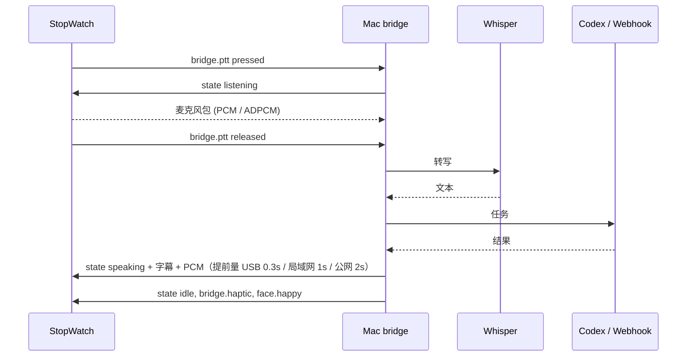

# 架构说明

## 组件



一个 Python 进程（aiohttp）承载所有 Mac 端功能。USB 和无线两条链路共用同一套 SCU1 帧协议和命令处理，USB 优先：USB 连上时无线链路会被主动断开。

| 文件 | 职责 |
|---|---|
| `src/bridge.py` | 状态机（录音 → 识别 → 执行 → 播报）、提醒队列、形象管理、控制台 HTTP API、各监听端口 |
| `src/device.py` | `Link` 基类：握手、心跳、请求/响应配对、PCM 播放节奏；`Device`：USB 串口 |
| `src/remote.py` | 无线入口（aiohttp WebSocket）、设备注册表（密钥哈希）、失败限速、局域网证书、Funnel 状态 |
| `src/protocol.py` | SCU1 帧编解码，可从噪声和分片中恢复 |
| `src/adpcm.py` | IMA ADPCM，公网时压缩语音 4:1 |
| `src/speech.py` | Whisper 转写与幻觉过滤、`say` 合成、按句切分 |
| `src/wake.py` | “让 Codex/Grok……”路由、名字唤醒（Silero VAD + 语句切分） |
| `src/codex_client.py` | `codex app-server` JSON-RPC 客户端，专用会话、审批转发 |
| `src/tunnel.py` | `cloudflared` 临时隧道，只暴露回调端口 |
| `src/xwatch.py` | X OAuth2 PKCE、Activity 订阅与长连接、事件文案 |
| `src/avatars.py` | 形象目录扫描、PNG → 基线 JPEG、`avatar.put` 分块 |
| `src/manage.py` | 启停、状态、登录项（launchd） |
| `src/dashboard.html` | 控制台单页 |

## 端口

| 地址 | 用途 | 暴露范围 |
|---|---|---|
| `127.0.0.1:18765` | 控制台与 API | 仅本机；非 GET 请求要求自定义头 `X-StopWatch-Client: local` 且同源 |
| `127.0.0.1:18766` | Webhook 结果回调 | 经 Cloudflare 临时隧道；只有 `/result/<任务>`，一次性令牌 |
| `127.0.0.1:18767` | 设备公网入口 | 经 Tailscale Funnel `:8443`；只有 `/device`，设备密钥 |
| `0.0.0.0:18768` | 设备局域网入口（TLS） | 局域网；只有 `/device`，设备密钥 |

## 运行时文件（`runtime/`，不入库，权限 700）

| 文件 | 内容 | 私密 |
|---|---|---|
| `grok.json` | Webhook 地址与 key | 是 |
| `x.json` | X 应用凭据与 OAuth 令牌 | 是 |
| `devices.json` | 无线设备密钥的 SHA-256 | 是 |
| `lan-cert.pem` / `lan-key.pem` | 局域网入口证书与私钥 | 是 |
| `codex-session.json` | 专用 Codex 会话编号 | 是 |
| `wake.json` / `voice.json` | 唤醒设置 / 播报声音与语速 | — |
| `events.jsonl` | 事件记录（超过 5MB 启动时轮换） | 含任务文本 |
| `bridge.log` 等 | 排障日志 | — |

## SCU1 帧

USB 串口和 WebSocket（一帧一条消息）都用同样的帧：

```
"SCU1" | ver u8=1 | type u8 | flags u8 | reserved u8 | seq u32 LE | len u32 LE | payload (≤ 8192) | crc32 u32 LE
                                                                                     CRC 覆盖 ver..payload
```

| type | 方向 | 内容 |
|---|---|---|
| `0x01` | 双向 | JSON 命令 / 事件 |
| `0x02` | Mac → 设备 | 播报 PCM（16kHz 16-bit mono） |
| `0x03` | 设备 → Mac | 麦克风包（MIC1 头 + PCM） |
| `0x08` / `0x09` | 双向 | ping / pong |
| `0x0A` / `0x0B` | 同 0x02 / 0x03 | ADPCM 压缩版，仅公网链路 |

## Mac Bridge 命令（JSON）

上游固件的命令（`state`、`display.speech_bubble.*`、`audio.*`、`streetpass.*` 等）保持不变，本项目新增：

| 命令 | 方向 | 说明 |
|---|---|---|
| `bridge.configure` | → 设备 | 启用 Mac 接入模式（按键改为对讲、关闭上游交互） |
| `bridge.ptt` / `bridge.action` | ← 设备 | A 键按下/松开；B 键单击（切换助手）、双击（停止） |
| `bridge.haptic` | → 设备 | 振动，最长 400ms |
| `bridge.agent` | → 设备 | 状态栏显示的助手名 |
| `notify.set` | → 设备 | 全量下发提醒图标：`[{kind, ttlSec}]`，设备本地计时过期 |
| `net.config.set` / `net.config.get` | → 设备 | 写入 / 读取 Wi-Fi、入口地址、设备密钥、局域网证书。**写入只接受 USB** |
| `net.lan.hint` | → 设备 | Mac 当前局域网地址 |
| `avatar.list` | → 设备 | 设备上的形象、当前形象、LittleFS 用量 |
| `avatar.put` | → 设备 | `{id, file, offset, size, data(base64 ≤4KB), final, crc}`；**只接受 USB** |
| `avatar.select` | → 设备 | 切换形象，`""` 为内置；USB / 无线均可 |
| `avatar.delete` | → 设备 | 删除一套形象；**只接受 USB** |
| `face.happy` | → 设备 | 回到待机后显示开心表情 `durationMs`（≤5000） |

`device.info` 的 `capabilities` 列出设备支持的功能（如 `net.config`、`audio.adpcm`、`notify.badges`、`avatar.store`、`face.happy`），Mac 端据此决定是否启用对应功能，旧固件不会收到不认识的命令。

## 一次对话的时序



## 固件改动

固件在 [BTCUP99/stackchan-pet-fw](https://github.com/BTCUP99/stackchan-pet-fw) 的 `mac-bridge` 分支，相对上游 v0.4.1：

- `NetLink.*`、`NetLinkRootCa.h`：Wi-Fi 连接、局域网探测、WSS 客户端（mbedTLS 内存放在 PSRAM，发送走独立任务）
- `Adpcm.h`：IMA ADPCM 编解码
- `AvatarStore.*`：形象存储、校验、切换
- `FaceController.*`：首页状态栏、提醒图标、形象目录优先、开心表情
- `main.cpp`：Mac Bridge 命令、按键映射、关闭好感度等上游交互
- `config.h`：`STACKCHAN_MAC_BRIDGE_HOME`、`STACKCHAN_AFFECTION_ENABLED` 开关

## 测试

```sh
.venv/bin/python -m unittest discover -s tests -v
```

覆盖：协议与 ADPCM、形象转换与分块、无线入口认证与限速、配对与提醒图标、X 事件解析、转写过滤、语音路由与唤醒。
