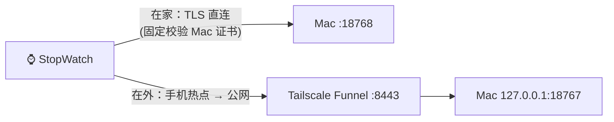

# 无线组网

插着 USB 走有线；拔掉后设备自动经 Wi-Fi 连回 Mac。



## 连接顺序

1. 无 USB 主机通信 10 秒且亮屏 → 依次连已保存的 Wi-Fi（最多 4 个，只支持 2.4GHz）。
2. 用 0.6 秒探测局域网里的 Mac：能连上就走 **局域网 TLS**（原始 PCM 音频，最快）。
3. 否则走 **公网入口**（Tailscale Funnel，Let's Encrypt 证书，固件内置 ISRG Root X1/X2；音频用 IMA ADPCM 压缩 4:1）。
4. 都失败显示红 ×（无 Wi-Fi）或橙 !（连不上 Mac），退避重试。
5. 走公网时每 2 分钟在空闲时探测一次局域网，回家后自动切回；插回 USB 立即切回有线；熄屏断开无线。

Mac 每次和设备连上都会把当前局域网地址发给设备，DHCP 换了地址也不用重新配对。

## 开启公网入口（可选）

只在家用可以跳过这一节。在外使用需要 [Tailscale](https://tailscale.com/)，并在 tailnet 管理后台允许 Funnel：

```sh
tailscale funnel --bg --https=8443 http://127.0.0.1:18767
tailscale funnel status
```

8443 只转发到设备入口 `127.0.0.1:18767`，它只接受 `/device` 且必须带设备密钥；控制台（18765）和其他端口都不对外。Funnel 只允许 443、8443、10000 端口；如果 443 已被你的其他服务占用，用 8443 即可。关闭：`tailscale funnel --https=8443 off`。

> 用 Clash 等代理的 TUN 模式时，建议让 Tailscale 的流量直连，否则延迟会明显增加。

## 配对

插 USB，控制台“无线组网” → 展开“插 USB 配对无线”：

- 填最多 4 个 Wi-Fi（设备按顺序尝试）。全部留空则保留设备里已存的网络，只更新密钥和局域网证书。
- iPhone 热点打开“最大化兼容性”，安卓热点选 2.4GHz。设备只认网络名称和密码，两部手机热点设成相同名称和密码就能互换。
- 点“写入设备”。拔掉 USB 约 10 秒后切到无线。

重新配对会停用这台设备之前的密钥。设备丢失时，在控制台对应设备上点 **停用**，它立即无法再连回 Mac。

## 安全模型

| 风险 | 处理 |
|---|---|
| 陌生人连入 | 每台设备一把随机密钥，只经 USB 写入；Mac 只存 SHA-256（`runtime/devices.json`）。两个入口都只接受 `/device`，失败限速并临时封禁。 |
| 伪造来源 IP | 只有来自本机 Funnel 代理的请求才采信 `X-Forwarded-For`。 |
| 局域网中间人 | 设备固定校验 Mac 的自签证书（`runtime/lan-cert.pem`，配对时写入）。删除证书后需重新配对。 |
| 凭据外泄 | Wi-Fi 密码、设备密钥只能经 USB 写入（网络链路上的 `net.config.set` 会被固件拒绝）；设备不回传它们。 |
| 设备被扫描 | 设备不监听任何端口，只主动连出。上游未认证的 Wi-Fi 服务和配网热点保持关闭。 |
| 写坏设备 | 形象上传、删除同样只接受 USB；切换形象可以走无线。 |

## 排障模式

```sh
STOPWATCH_DIAG_NO_USB=1 .venv/bin/python src/manage.py start
```

后台不占 USB 口，设备插着线也走无线，同时可以用串口工具读日志。排查完 `manage.py stop` 后正常启动。控制台“无线组网”会显示最近几次连接尝试的结果（不含密钥）。

## 为什么公网要压缩、要提前发送

设备的 TCP 窗口只有约 5.7KB，公网路径往返较长，原始 PCM 跟不上播放速度。所以公网时音频压缩 4:1、Mac 提前 2 秒发送；局域网提前 1 秒；USB 0.3 秒。
